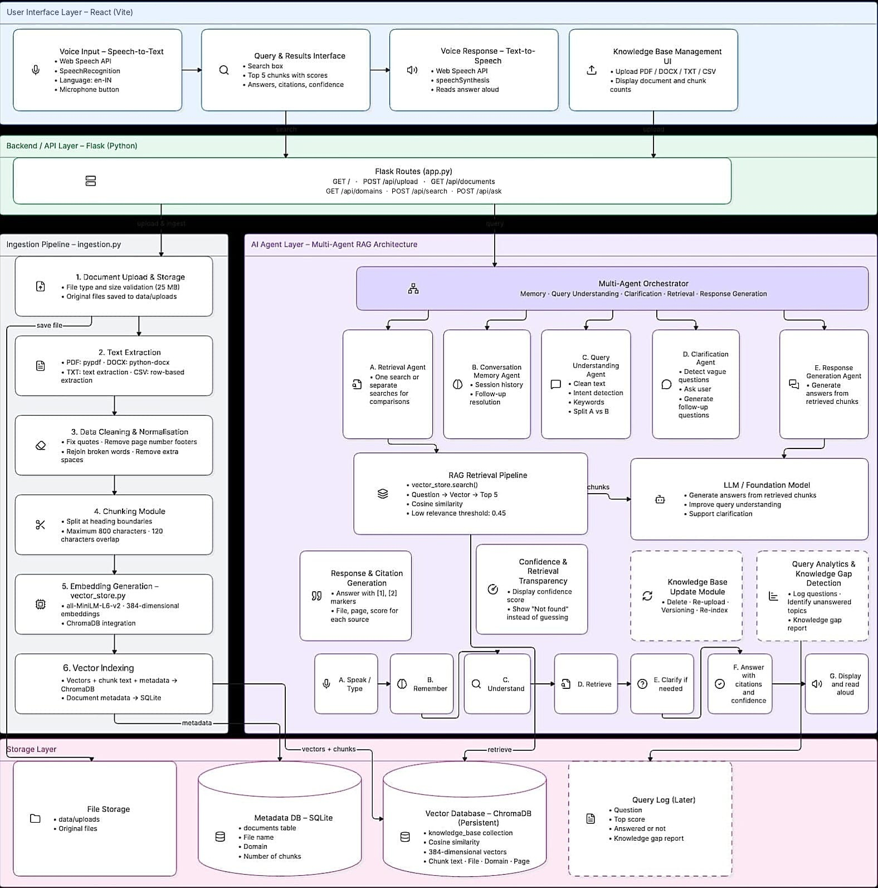

# Development of AI-Based Knowledge Retrieval Platform with Query Resolution System

**Milestone 1:** knowledge base ingestion (PDF, DOCX, TXT, CSV → extraction → cleaning → chunking → embeddings → ChromaDB) and semantic retrieval.

**Milestone 2:** multi-agent query resolution and response generation:

```
User Query → Query Understanding Agent → Retrieval Agent → Response Generation Agent → Final Response
```

- **Query Understanding Agent:** classifies the query as factual, procedural, comparative or ambiguous, and routes it.
- **Retrieval Agent:** semantic search, ranking by relevance score, low-confidence filtering.
- **Response Generation Agent:** grounded answer from the retrieved chunks (Groq LLM), with source attribution and a confidence indicator.
- **Orchestrator:** runs the three agents in order, with error handling.

**Built with:** Python + Flask, ChromaDB, SQLite, Groq API (LLM), React + Vite (frontend).



## How to run

You need Python 3.10+, Node.js 18+ and a free Groq API key from https://console.groq.com/keys.

**1. Backend** (terminal 1, in the project folder):

```bash
pip install -r requirements.txt
copy .env.example .env      # Windows (Mac/Linux: cp .env.example .env), then put your key in .env
python app.py               # API on http://localhost:5000
```

**2. Frontend** (terminal 2):

```bash
cd frontend
npm install
npm run dev                 # open http://localhost:5173
```

Upload the files in `sample_docs/hr_policy` with the domain `hr_policy`, and the files in `sample_docs/smart_home_support` with the domain `smart_home_support`. Then ask questions.

The first run downloads the embedding model (about 80 MB).

## Tests and evaluation

```bash
pytest                      # 23 tests (Milestone 1 + Milestone 2); no API key needed
python evaluate.py          # Milestone 1 retrieval evaluation -> evaluation/results.md
python evaluate_agents.py   # Milestone 2 evaluation -> evaluation/milestone2_results.md
```

## Files

```
app.py                      Flask API routes
config.py                   settings (chunk size, top-k, min score, Groq model)
ingestion.py                text extraction, cleaning, chunking
vector_store.py             embeddings + ChromaDB (store and search)
database.py                 SQLite list of uploaded documents
agents/
  query_understanding.py    M2.1 Query Understanding Agent
  retrieval_agent.py        M2.2 Retrieval Agent
  response_agent.py         M2.3 Response Generation Agent
  orchestrator.py           M2.4 multi-agent orchestration layer
  schemas.py                standard request/response format between agents
  prompts.py                LLM prompts
  llm.py                    Groq API wrapper
frontend/                   React app (upload, ask, answers with sources and confidence)
evaluate.py                 Milestone 1 retrieval evaluation
evaluate_agents.py          Milestone 2 evaluation
sample_docs/                test documents: 2 domains x 4 file types
evaluation/                 test queries + results
tests/                      automated tests
docs/                       research, architecture, tech stack, evaluations
```

## API

| Method | Route | What it does |
|---|---|---|
| POST | `/api/upload` | Upload files (form fields `files`, `domain`) |
| GET | `/api/documents` | List uploaded documents |
| GET | `/api/domains` | List domains |
| POST | `/api/search` | `{"question", "top_k", "domain"}` → most relevant chunks with scores |
| POST | `/api/ask` | `{"question", "domain"}` → answer, query type, sources, confidence (multi-agent pipeline) |

## Results

| Milestone | Test | Result |
|---|---|---|
| 1 | Retrieval, 40 questions | Top-1 96.9 %, Top-3 100 %, Top-5 100 % |
| 2 | Query classification, 41 queries | see `evaluation/milestone2_results.md` |
| 2 | End-to-end answers | run `python evaluate_agents.py` with your Groq key |

Details are in [`docs/5_milestone2_agents.md`](docs/5_milestone2_agents.md).
