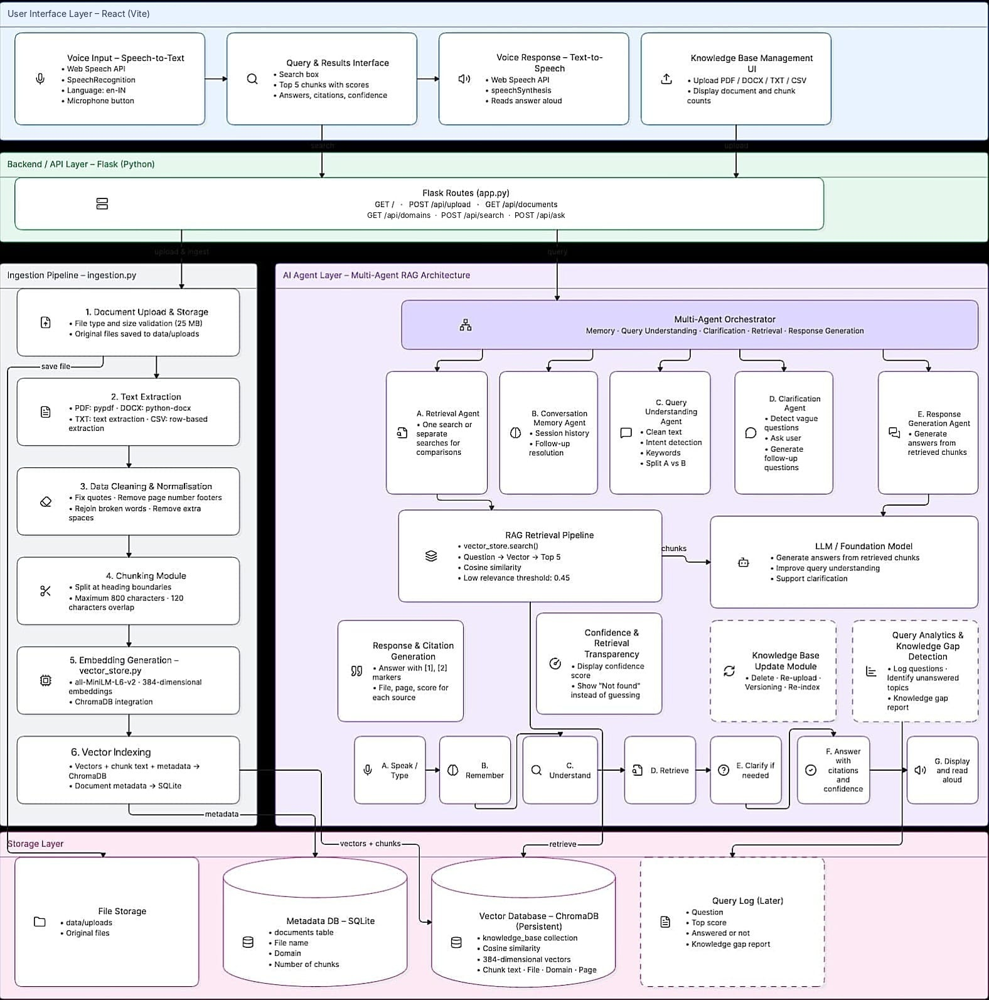

# M1.2 System Architecture



The diagram has five layers:

| Layer | What it contains |
|---|---|
| User Interface (HTML, CSS, JavaScript) | Voice input (Speech-to-Text), query & results interface, voice response (Text-to-Speech), knowledge base management UI |
| Backend / API (Flask) | Flask routes in `app.py`: `GET /`, `POST /api/upload`, `GET /api/documents`, `GET /api/domains`, `POST /api/search` |
| Ingestion Pipeline (`ingestion.py`) | 1. Upload & storage → 2. Text extraction → 3. Cleaning & normalisation → 4. Chunking → 5. Embedding generation → 6. Storing |
| AI Agent Layer | Multi-agent orchestrator; Retrieval, Conversation Memory, Query Understanding, Clarification and Response Generation agents; RAG retrieval pipeline; LLM; response & citation generation; confidence & retrieval transparency; knowledge base update; query analytics & knowledge gap detection |
| Storage | File storage (`data/uploads`), metadata DB (SQLite), vector database (ChromaDB), query log (later) |

## Components

| Component | Where | Milestone 1 |
|---|---|---|
| Knowledge Base Management UI (upload, document list) | `templates/index.html`, `static/app.js` | Built |
| Results interface (top chunks with scores) | `static/app.js` | Built |
| Backend / API layer | `app.py` (Flask) | Built |
| Document upload & storage | `app.py` → `data/uploads/` | Built |
| Text extraction (PDF, DOCX, TXT, CSV) | `ingestion.py` | Built |
| Data cleaning & chunking | `ingestion.py` | Built |
| Embedding generation | `vector_store.py` | Built |
| Vector database / semantic search | `vector_store.py` (ChromaDB) | Built |
| Document metadata database | `database.py` (SQLite) | Built |
| RAG retrieval pipeline | `vector_store.search()`, `/api/search` | Built |
| AI agent layer (5 agents) + multi-agent orchestrator | – | Designed (below), built later |
| LLM / foundation model | – | Later |
| Response & citation generation | – | Designed, built later |
| Confidence & retrieval transparency | similarity scores + low-relevance flag | Scores built; confidence later |
| Voice input / voice response (Web Speech API) | – | Studied, built later |
| Query analytics & knowledge gap detection | – | Later |
| Knowledge base update module | – | Later |

## Agent responsibilities

| Agent | Input → Output | Planned behaviour (first version) | Later |
|---|---|---|---|
| Conversation Memory | question → question with context | Keeps the last 10 turns per session; adds the previous question to follow-ups ("and what about…") | LLM rewrites follow-ups |
| Query Understanding | question → {text, intent, keywords, sub_questions} | Removes fillers; finds the intent with keywords; splits "A or B" | LLM |
| Clarification | query → follow-up question or nothing | Asks back if the question has no content words or is a single word | LLM writes the question |
| Retrieval | query → top chunks | One search, or one per side for comparisons | Hybrid keyword + vector search, re-ranking |
| Response Generation | query + chunks → answer, citations, confidence | Best sentences with [n] markers; "not found" if the best score is below 0.45 | LLM writes the answer from the chunks |

## Orchestration flow (designed)

```
Question (typed, or spoken → SpeechRecognition)
   │  POST /api/ask
   ▼
1. Conversation Memory Agent   add context from the previous question
2. Query Understanding Agent   clean, intent, keywords, sub-questions
3. Clarification Agent         too vague? → return a question to the user (stop)
4. Retrieval Agent             search ChromaDB (top 5)
5. Response Generation Agent   answer + citations + confidence, or "not found"
   │  save turn in memory
   ▼
JSON response → shown on the page → read aloud with speechSynthesis
```

## Data flow

```
Upload → check file type → save file → extract text → clean
       → split at headings → chunks (800 chars, 120 overlap) → embeddings (384 numbers each)
       → ChromaDB (vector + text + metadata)  and  SQLite (one row per document)

Question → embedding → ChromaDB top 5 (cosine similarity) → chunks with scores (low relevance below 0.45)
```

Implemented in Milestone 1: every step above. Proposed for later milestones: after retrieval, the agents → answer with sources → text / voice response.

## Data models

**Document** (SQLite table `documents`)

| Field | Example |
|---|---|
| id | `1c111b3b` |
| filename | `leave_policy.docx` |
| file_type | `docx` |
| domain | `hr_policy` |
| num_chunks | `9` |
| uploaded_at | `2026-11-14T11:35:46` |

**Chunk** (ChromaDB collection `knowledge_base`)

| Field | Example |
|---|---|
| id | `1c111b3b_3` (document id + chunk number) |
| document | the chunk text |
| embedding | 384 numbers from all-MiniLM-L6-v2 |
| metadata | `{doc_id, filename, domain, chunk_index, page}` |

**Query** (designed, used by the agents)

`{"text": "What is the difference between casual leave and sick leave?", "intent": "comparative", "keywords": ["casual", "leave", "sick"], "sub_questions": ["casual leave", "sick leave"]}`

**Retrieval result** (one per chunk returned by `/api/search`)

`{"rank": 1, "text": "...", "filename": "leave_policy.docx", "domain": "hr_policy", "page": null, "score": 0.802, "low_relevance": false}`

**Response** (designed, for the future `/api/ask`)

`{"answer": "... [1]", "citations": [{"number": 1, "filename": "leave_policy.docx", "page": null, "score": 0.802}], "confidence": 0.802, "intent": "factual", "needs_clarification": false, "results": [...], "steps": ["memory", "query_understanding", "retrieval", "response_generation"]}`